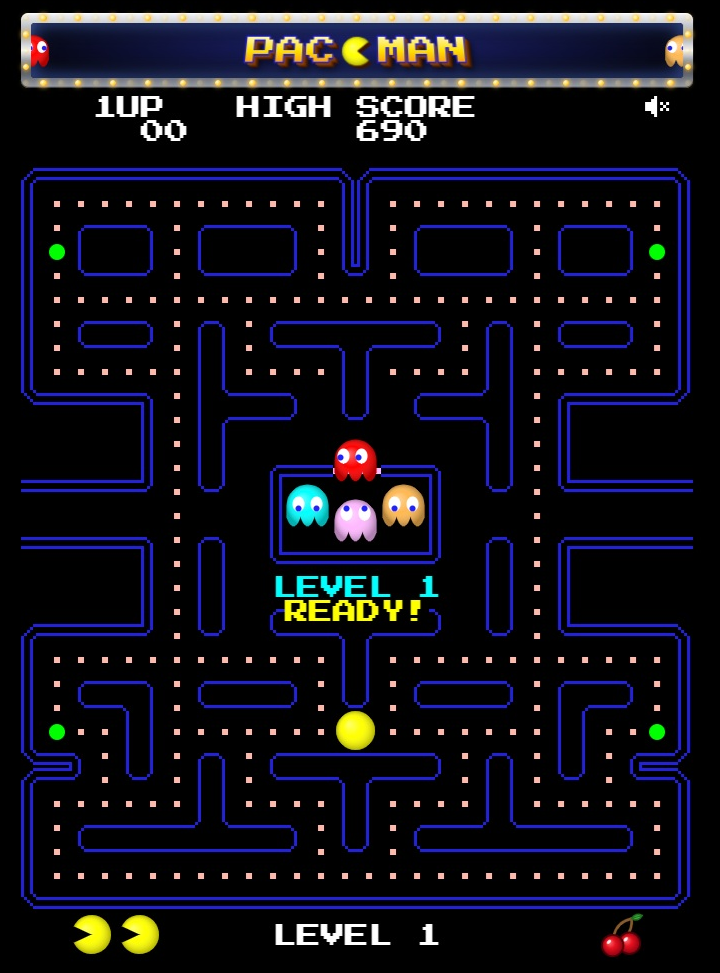
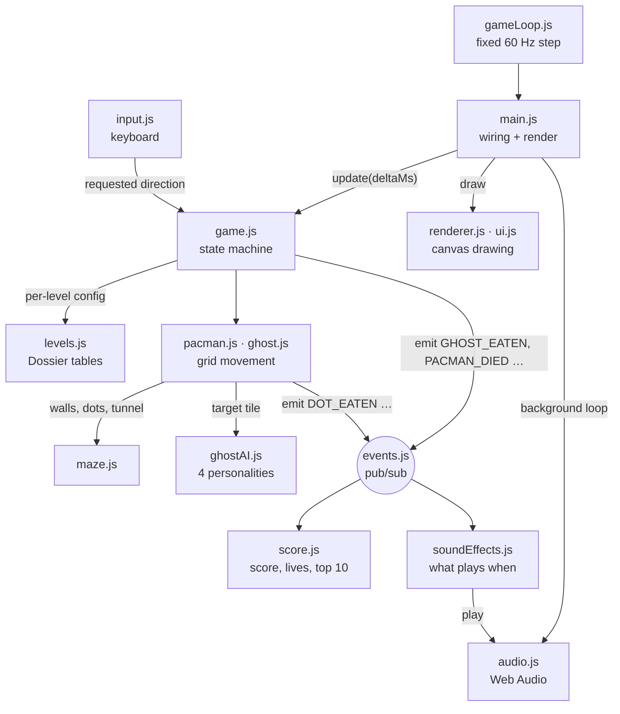

# Pac-Man (1980) Recreation

A recreation of the 1980 arcade Pac-Man in vanilla JavaScript and HTML5 Canvas, with the original ghost AI and level rules, no libraries and no build tools.

<!-- TODO: replace with the real URL after the deploy -->
**[▶ Play it live](https://USERNAME.github.io/REPO/)**



## Controls

| Key | Action |
|---|---|
| Arrow keys / WASD | Move Pac-Man |
| Enter | Start a game; confirm your name in the top 10 table |
| P | Pause / resume |
| M | Mute / unmute (remembered) |

**Entering your name** (top 10 score): type letters, digits and spaces, Backspace deletes, or arcade-style:
↑ ↓ step through the letters, ← → move the cursor. Enter confirms.

## Features

### Faithful to the 1980 arcade
Rules follow **The Pac-Man Dossier** by Jamey Pittman:

- **Ghost AI with four personalities**: Blinky chases Pac-Man's tile, Pinky aims 4 tiles ahead (including the original "facing up" overflow bug), Inky uses Blinky's position, and Clyde gets shy within 8 tiles.
- **Scatter / chase waves** with each level's timing, a frightened mode with flashing, ghosts that reverse direction on a mode change, and the four tiles where ghosts may not turn up.
- **The level table**: speeds for Pac-Man and ghosts (normal, frightened, tunnel), frightened time and flashes, bonus fruit and points, from level 1 to 21+.
- **Ghost house release**: per-ghost dot counters, the global counter after a lost life, and the "no dot eaten" timer.
- **Cruise Elroy**: Blinky speeds up near the end of a level.
- **Movement details**: cornering (turning a few pixels before the center), the 1-frame pause per dot and 3 frames per power pellet, and slow ghosts in the tunnel.
- **Scoring**: 10 / 50 points, ghosts 200 → 400 → 800 → 1600, fruit at 70 and 170 dots, an extra life at 10,000.

### Deliberate deviations
- **Smooth vector graphics** instead of pixel art: Pac-Man, the ghosts and the fruits are canvas drawings (some fruits redrawn: an orange, a melon, our own spaceship).
- **Own sound design**: ready-made MP3 files, not the arcade's sounds.
- **All four ghosts start in the house**, and Pac-Man waits for the first key instead of moving at once.
- **Eaten ghosts wait in the house** until frightened mode ends.
- **Longer frightened time on levels 1–4** (8 / 6 / 5 / 4 s instead of 6 / 5 / 4 / 3 s) for a gentler start.
- **Power pellets pulse** instead of blinking.
- **The HUD shows the level number**, and 4 fruit icons instead of 7.
- **A top 10 table** with names of up to 10 characters (saved in the browser), our own ghost nicknames, an animated title screen and an arcade sign above the game.

## How it works

The game runs at a fixed 60 updates per second. `game.js` is a state machine (START → READY → PLAYING → DYING / LEVEL_COMPLETE → GAME_OVER → NAME_ENTRY). Game modules never call the sound or score code directly: they `emit` events through `events.js`, and the listeners decide what to do.



## Run it locally

ES modules need a local web server (opening `index.html` as a file won't work).

1. Open the folder in VS Code.
2. Right-click `index.html` → **Open with Live Server**.

On `localhost` / `127.0.0.1` only, the Backquote key (`` ` ``) turns on the developer tools (FPS, ghost targets, galleries, test keys). They are off on the public site.

### Tests

Requires Node.js 20 or newer. No packages to install.

```bash
npm test
```

Tests are written with the built-in `node:test` runner and live in `tests/` (ghost AI targets, level tables, maze, scoring, input, audio loading).

## Tech

- Vanilla JavaScript (ES modules), no libraries, no frameworks, no build step
- HTML5 Canvas 2D, drawn at the device's full resolution with whole-number scaling
- Web Audio API (decoded buffers, a mixer with buses, compressor and limiter)
- `localStorage` for scores and settings
- `node:test` for the tests

## What I learned

- **Web Audio**: decoding files once into buffers, routing them through buses, a compressor and a limiter, and why the browser only allows sound after the first key or click.
- **Decoupling with events**: the game only announces what happened; one module decides which sound plays, so the game logic knows nothing about audio.
- **Pure functions**: the background music is decided by one function of the game state, so it can never be left playing by mistake and is easy to test.
- **Fades, ramps and ducking**: changing volume smoothly avoids clicks, and lowering the music for a moment keeps important sounds audible.
- **Code review before fixing**: reading the whole codebase first, giving every finding an ID, and fixing each one in its own commit.
- **Testable code**: passing dependencies in (`new Game({ input })`) and using fakes for the browser APIs lets the game run in Node.
- **Tests first for a bug**: a failing test that shows the bug, then the fix, and a reminder that a test only proves what it checks.

## Credits

- **Sounds**: see [assets/audio/CREDITS.md](assets/audio/CREDITS.md).
- **Font**: [Press Start 2P](https://fonts.google.com/specimen/Press+Start+2P) by CodeMan38, SIL Open Font License 1.1 (loaded from Google Fonts).
- **Rules reference**: *The Pac-Man Dossier* by Jamey Pittman.

## License

My code is released under the [MIT License](LICENSE). The audio files in `assets/audio/` keep their own licenses, listed in [CREDITS.md](assets/audio/CREDITS.md). The font keeps its own license.

## Disclaimer

Fan-made educational recreation. Pac-Man is a trademark of Bandai Namco. This project is not affiliated with or endorsed by Bandai Namco.
